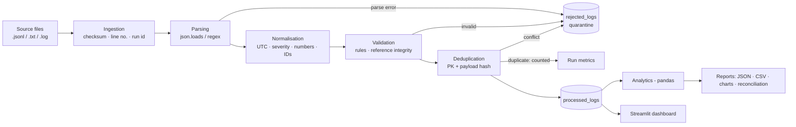

# Architecture

## Pipeline flow

## Layers → modules
| Layer | Module | Responsibility |
|---|---|---|
| Source systems | `data/*`, `generator.py` | JSON-Lines and text log files (synthetic, seeded) |
| Ingestion | `ingestion.py` | discover files, tolerate missing/empty/binary/unreadable, SHA-256, line numbers |
| Parsing | `parser.py` | JSON → dict, text → regex; never raises, always keeps the raw line |
| Transformation | `transformation.py` | column names, UTC timestamps, severity aliases, numeric latency, missing tokens, deterministic IDs, late/out-of-order flags, derived fields |
| Validation | `validation.py` | rule engine (all reasons collected), duplicate/conflict detection, quarantine record builder |
| Storage | `storage.py`, `schema.sql` | SQLite, transactions, idempotent inserts, run/file registry, retry classification |
| Analytics | `analytics.py` | error, latency and operational metrics (pandas) |
| Reporting | `reporting.py` | CSV exports, JSON reports, reconciliation, charts |
| Orchestration | `pipeline.py`, `run_pipeline.py` | stage wiring, per-file atomicity, retries, status |
| Observability | `logger.py` | console + rotating file logs, `RunMetrics` (run id, timings, counts, status, failure reason) |

## Error handling & quarantine flow
* **Parse failure / validation failure / ID conflict** → row in `rejected_logs` (stage, reasons, raw line, file, line number). Never dropped.
* **File-level problem** (missing, binary, unreadable) → recorded in the run, other files continue.
* **DB failure** → the file’s transaction rolls back (nothing partial), file marked `FAILED`, other files continue, run = `PARTIAL_FAILURE`; if every file fails (or there is no input) the run is `FAILED`.
* **Report-generation failure** → data stays committed; run downgraded to `PARTIAL_FAILURE` with the reason.

## Run status
`SUCCESS` (no file-level failure) · `PARTIAL_FAILURE` (≥1 file failed, ≥1 succeeded/skipped) · `FAILED` (nothing succeeded or no input).
Rejected *records* are expected data-quality outcomes and do not make a run fail.

## Counting invariant
`input_records = inserted + duplicates + rejected` on every run (checked by the reconciliation report).
